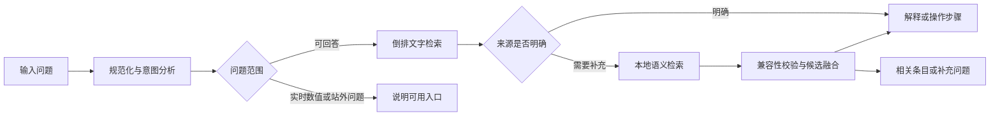

# 本地搜索：接口、排序与运行约定

## 用户流程

一个输入框自动处理科学知识、网站用法、教学和开发问题，不增加分类开关。返回内容来自站内资料，不生成无来源事实，不执行实验动作，也不读取当前实验的科学数值。参考资料默认折叠，界面不展示实现原理、模型型号或下载体积。

## 文件与所有者

| 文件 | 唯一职责 | 不负责 |
| --- | --- | --- |
| `site/assistant/ui.js` | DOM、对话、焦点、语言、复制、当前问题与取消信号 | 网络版本、Worker 请求队列、实验操作 |
| `site/assistant/runtime.js` | 资料加载、模块版本、共享准备、Worker 生命周期、超时、取消和重试 | 页面节点、检索评分、科学状态 |
| `site/assistant/search.js` | 查询分析、倒排索引、来源答案选择、候选融合、短追问 | 下载模型、页面状态和自由生成 |
| `scripts/assistant/worker-source.js` | 本地 BGE 推理、向量点积、文档分块去重 | 读取实验状态、决定是否直接回答 |
| `scripts/build-assistant-knowledge.py` | 保留稳定 ID、同步当前手册、补丁与来源、生成版本 | 批量升级审核状态 |
| `scripts/document_model.py` | 双语结构校验、共享函数索引和章节文本提取 | 页面 DOM 或运行时查询 |
| `scripts/assistant/build.mjs` | 固定运行库打包与离线文档向量构建 | 浏览器问题日志 |

## 查询接口

`analyzeQuery(text)` 返回 `text`、`normalized`、`core`、`kind`、`usage`、`operation` 与去重的 `terms`。`selectAnswer`、`selectSemanticAnswer`和`combineCandidates`同样接受已经分析的查询对象。`createSearch(records)` 预先建立词频、文档长度惩罚、逆文档频率、词项倒排表和标题/核心问法索引；返回的检索函数同时接受原始问题与已经分析的查询对象。

一次提问复用同一个分析结果和文字结果，不为诊断面板重复检索。语料的 ID、功能主题和关闭操作匹配表按资料数组缓存，资料被释放后可随 WeakMap 回收。

- 中文保留连续二字词；问法核心移除礼貌前缀和结尾，不移除“自定义”中的“定义”。
- 英文先按单词处理礼貌前缀和冠词，`theme` 不会被误删为 `me`。复数词形保持 `phase/phases`、`city/cities` 等关系。
- `API`、`state` 等开发词按词边界识别，普通单词 `capital` 不会被当作开发请求。
- 明确的打开、设置、保存等操作优先选择用法；计算公式仍属于知识。“为什么太阳使用核聚变”中的“使用”不是操作网页。
- 删除、保存、导入、导出、关闭等动作保留独立语义，不因问法核心相近就互相代替。

`compatible(query, card)` 是文字检索、语义选择和建议条目的共同类别规则。分类发生在内部，不要求用户手动选类型。模糊问题依赖来源匹配，不承诺覆盖全部自然语言。

## 文字排名和直接回答

词频评分采用带长度归一化的 BM25 式计算，候选仅来自有匹配词项、完整标题或核心问法的文档。不是每次遍历全部正文再切词。

| 证据 | 当前加分或条件 |
| --- | --- |
| 完整标题匹配 | 2000 |
| 别名匹配 | 1800 |
| 问题包含较长完整问法 | 1000 |
| 核心问法一致 | 800 |
| 非 draft 的明确匹配 | 250 |
| 科学或教学类别一致且有词项证据 | 12 |
| 关键操作相反 | 降为原分数的 0.1 |
| 一般强文字匹配 | 覆盖率至少 0.72、分数至少 12、领先次项 1.28 倍 |

精确标题、经源码核对的任务流程、关闭变体和核心问题有独立选择路径。`draft` 资料允许在明确来源匹配时引用原文；审核状态仍保留在 References，不等于已逐项完成交互核验。

## 语义和混合候选

BGE-small-zh-v1.5 INT8、512 维 CLS、归一化向量；中文模型不等于完整多语言能力。Worker 返回最多 12 个去重文档候选，UI 诊断保留 Top 5。当前中英文手册全文均参与文字检索；中文正文以重叠窗口离线分块，多个块按同一文档最高分合并。

直接采用语义答案仍要求：分数至少 0.7；与下一兼容条目差至少 0.07；存在独立文字证据且覆盖率至少 0.5；关键操作一致。文字核对可以按ID查询已建立的语料词频，不要求语义来源恰好位于文字Top 5；仍须有实际词项证据。不能仅通过降低阈值解决缺少资料。

`combineCandidates` 只负责建议列表：使用 reciprocal rank fusion（分母从 61 开始）合并文字与分数至少 0.5 的语义结果，按 ID 去重并再次检查类别。弱语义结果不会清空有用的文字候选；候选融合本身不授权自动回答。

`contextualQuery` 仅把城市比较之后的短追问“怎么保存”等关联到完整实验保存。包含“保存”的长问题不继承该上下文。对话不是通用长期记忆。

## Runtime 生命周期

`createRuntime(scriptUrl)` 提供 `load()`、`prepare()`、`semantic(query, {signal})`、`dispose()`。

1. `load()` 共享一次资料请求和索引创建；校验 schema、版本、记录数和唯一 ID。
2. `prepare()` 在页面进入时自动启动，多个调用共用一个 Worker 和准备请求；成功保留模型。
3. `semantic()` 等待共享准备，可在准备前或推理中由 AbortSignal 取消自己的等待，不终止其他请求或后台准备。
4. 每个请求有独立 ID、定时器与清理；旧结果不能结束新请求。旧 Worker 事件不能破坏重试创建的新 Worker。
5. 准备超时为 120 秒，推理超时为 90 秒；Worker 失败清理当前代请求并允许后续重试。UI 保留文字回退。
6. `dispose()` 只负责明确释放，不在关闭搜索面板时释放模型。

资料 JSON 与向量元数据使用 `cache: no-cache` 进行重新验证；运行模块和 Worker URL 带 UI 的资源版本。模型权重和 WASM 的稳定路径继续使用浏览器缓存。Worker 核对索引 SHA-256、字节长度和知识版本，拒绝混合版本。页面可见不代表下载和预热已经完成。

## 来源和重建

原作者 625 个 ID 保留；另外 8 条基础科学资料有外部科学来源。站内说明、科学条目、当前手册、源码索引的身份和审核状态分别保存。章节全文从当前 `document-content.json` 提取段落、步骤、列表、表格、代码与生成字典，不继续使用旧手册快照覆盖当前发布说明。

完整构建顺序见 [搜索维护说明](../assistant/README.md)。`--runtime-only` 只重打包运行时代码，并检查既有知识版本和索引哈希；知识内容变化必须完整重建。不可编辑生成的 `knowledge.json`、`index.bin` 或手动跳过版本检查。

## 诊断、隐私与验证

问题仅留在当前页内存。`SkyAssistantDebug.getLast()` 提供本次原问法、规范化、类别、Top 5、采用路径、选择/拒绝原因和来源 ID；不发送或持久化问题。页面只显示内容、必要的等待或错误消息。

`assistant-corpus.cjs` 是基于来源的覆盖探针，不能作为独立准确率。`assistant-runtime.cjs` 用可控 Worker 验证并发、取消、迟到事件和重试。`assistant-prototype.cjs` 使用真实本地模型检查实际推理、回退、DOM 安全、语言、手机空间和子路径。全仓库静态解析、文档生成与功能交互是不同检查，不能互相替代。测试在开发机 Chromium 运行，不能声称等同于真实 iPad/Safari 测量。
